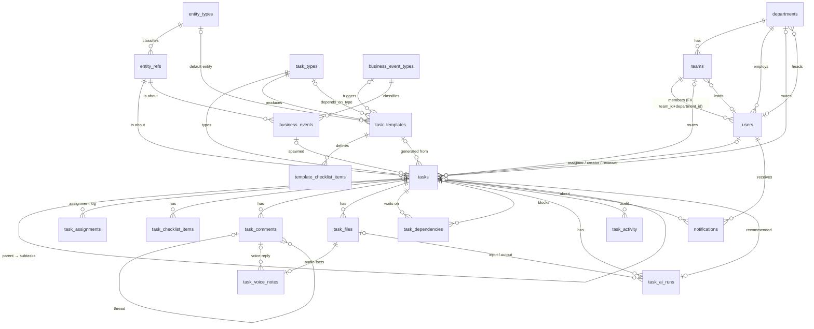

# Database Design — Decoinks Task Management (v2)

**Status:** Proposed · **Date:** 8 Oct 2026 · **Supersedes:** §5 of [TECHNICAL_DESIGN.md](TECHNICAL_DESIGN.md)

| Artifact | Purpose |
|---|---|
| [database/schema.target.prisma](database/schema.target.prisma) | Authoritative model: every table, column, type, FK, index |
| [database/schema.target.sql](database/schema.target.sql) | PostgreSQL DDL generated from the Prisma file (21 tables, 50 FKs) |
| [database/constraints.sql](database/constraints.sql) | CHECKs and partial unique indexes Prisma can't express (ships in the same migration) |

This document explains the *why*. The column-level truth lives in the Prisma file and is not repeated here.

**Verification:** the DDL and constraints were applied to PostgreSQL 16 (PGlite). A full chain was inserted: department → team → user → entity → template → event → task → assignment → file → voice note → AI run → activity. All 19 integrity probes in §8 were rejected as intended, the valid edge cases were accepted, and hard-purging a task removed exactly its owned rows and nothing else.

---

## 1. Audit of the current schema

The current schema (`server/prisma/schema.prisma`, 11 models, SQLite) works, but it grew one feature at a time. These problems drive the redesign.

### 1.1 Redundancy (the same fact stored more than once)

| # | Where | Problem |
|---|---|---|
| R1 | `Task.voiceNote`/`voiceTranscript`, `TaskVoiceNote.audioData`, `Comment.audioData`/`audioTranscript` | Voice audio is modeled **three different ways**. The single-note columns on `Task` are left over from before `TaskVoiceNote` existed. |
| R2 | `TaskFile.dataUrl`, all `audioData` columns | Binary content is stored as base64 inside the DB: +33% size, bloated backups, and every row read risks pulling megabytes. The original spec (§5.4) already said "metadata only; audio lives in file storage". |
| R3 | `TaskTemplate.checklistJson` | A list held in a JSON string (breaks 1NF) while tasks use a real `ChecklistItem` table. The same concept exists twice in two shapes. |
| R4 | `TaskTemplate.usageCount` | A counter that can be derived as `COUNT(tasks WHERE template_id = …)`. It drifts because tasks get purged. |
| R5 | `Task.metadata = {fromTemplate, aiFirstAttempt}` | The template link is hidden inside JSON instead of being a foreign key. |
| R6 | `AiRun.inputImageUrl` | Stores the **file name** of a `TaskFile`, which copies data and links nothing. |
| R7 | `AssignmentHistory.previousUserId` | Duplicates the previous row's `assignedUserId`. |
| R8 | `ChecklistItem.isCompleted` + `completedAt`, `Notification.isRead` | Two columns for one fact, so they can disagree. |
| R9 | `taskType` / `entityType` free strings on Task, Template, `dependsOnTaskType`; `actionType` back-filled from `taskType` in `seed.js` | No catalogue. `actionType` depends on `taskType` (the seed proves it), but that dependency is enforced nowhere. Typos create new "types". |
| R10 | `Comment.commentText = '🎤 Voice note'` | Placeholder text is written to satisfy `NOT NULL`, so fake data stands in for "no text". |

### 1.2 Missing connectivity (references with no foreign key)

| # | Column(s) | Consequence |
|---|---|---|
| C1 | `ChecklistItem.completedById`, `AssignmentHistory.previousUserId`/`assignedById`, `TaskFile.uploadedById`, `TaskTemplate.createdById` | Orphan IDs are possible and these can't be joined in Prisma. |
| C2 | `Comment.parentCommentId` | Threads are declared but have no self-relation. |
| C3 | Teams | Don't exist. `admin.js` makes them up as `ceil(members/2)`. |
| C4 | Department head | Guessed as "first ADMIN in the department". |
| C5 | `entityType` + `entityId` | No anchor for the external ERP record, so events and tasks about the same artwork share only a string. |
| C6 | Business events | Not persisted. Idempotency is a heuristic: `events.js` skips if an open task of that type exists. |

### 1.3 Integrity bugs found while reading the code

| # | Where | Bug |
|---|---|---|
| B1 | `tasks.js` and `templates.js` `nextTaskNo()` | `taskNo = count + 128` races (two concurrent creates get the same number) and is copy-pasted in two code paths. After any hard delete it **reissues numbers that already exist**. |
| B2 | `stateMachine.js` `canPerform` | The reviewer guard checks `createdById`, not `reviewerId`, so the `reviewerId` column has no effect. |
| B3 | `POST /:id/assign` | Never sets `releasedAt` on the previous `AssignmentHistory` row. The `accept` transition never sets `acceptedAt`. |
| B4 | All child FKs `ON DELETE RESTRICT` | `purge-demo.mjs` has to delete tables by hand in the right order, and it **forgets `TaskFile` and `TaskDependency`**, so the purge fails once those exist. |
| B5 | `ai.js` | Runs Pillow via a hard-coded `/usr/bin/python3` against the base64 blob. Not a DB issue, but the R2 fix (object storage) removes the decode-to-temp-file step. |
| B6 | Users | Can't be deactivated. Deleting one fails on RESTRICT, so a leaver can only be kept active or orphaned. |
| B7 | `PATCH /:id/checklist/:itemId` | Updates by `itemId` without checking it belongs to `:id`, so anyone can tick items on another task they can't see. |

---

## 2. Design principles

1. **One fact, one place.** If a value can be derived from other columns, it isn't stored. The few exceptions are listed explicitly in §5, each with its invariant and how it's enforced.
2. **Every reference is a foreign key**, with a deliberate `ON DELETE` rule (§7).
3. **State vs. log.** `tasks` holds *current state*. `task_activity` and `task_assignments` are *append-only history*. History rows are immutable facts, so they aren't redundant copies of state.
4. **No binaries in the database.** Rows hold a `storage_key` into object storage (Azure Blob / S3; local disk in dev).
5. **Closed sets are enforced by the database**: Postgres enums, plus CHECK for `status` because its labels contain spaces and are part of the API contract. Sets that admins edit (task types, entity types, event types) are lookup tables.
6. **Postgres everywhere, including dev.** Enums, `jsonb`, partial indexes, `timestamptz` and CHECKs don't exist (or behave differently) on SQLite. Dev/prod parity removes a whole class of "works on my machine" bugs.
7. **snake_case in the database, camelCase in Prisma**, mapped with `@map`, so raw SQL and BI tools never need quoted identifiers.

---

## 3. Entity-relationship diagram



`task_number_sequences` stands alone (a counter keyed by year).

---

## 4. Tables by domain

### 4.1 Organisation: `departments`, `teams`, `users`
- **Team membership can't contradict department membership.** `users(team_id, department_id)` is a composite FK to `teams(id, department_id)`, so a Design user can't sit in a Sales team. Postgres skips composite FKs when one column is NULL (`MATCH SIMPLE`), so a CHECK (`team_id IS NULL OR department_id IS NOT NULL`) closes that gap. `tasks` uses the same pair.
- `departments.head_user_id` and `teams.lead_user_id` replace the "first admin" heuristic (C4).
- `users.is_active` replaces deletion (B6). `users.daily_capacity` replaces the hard-coded `capacity: 8` in `users.js`.
- `users.role` (enum) is the **permission set**; `department_id` is the **org unit**. They're independent on purpose (an ADMIN can sit in Sales).

### 4.2 Reference data: `entity_types`, `entity_refs`, `task_types`, `business_event_types`
- These four lookup tables replace free-text strings (R9). Natural `code` keys (`BACKGROUND_REMOVAL`) keep rows readable and FK joins optional for display.
- **`entity_refs`** is the local anchor for an external ERP record (`ARTWORK / AW-2026-000125`, display name "Marine Family Logo"). Records live in `decoinks_db`, so a cross-database FK is impossible. This table gives tasks *and* events one row to join on (C5) and one place for the display name.
- `task_types.default_action_type` holds the A/H/G classification once. `tasks.action_type` is seeded from it and may be overridden per task (for example when an AI attempt falls back to a human), which is why the instance column stays (§5).

### 4.3 Templates & automation: `task_templates`, `template_checklist_items`, `business_events`, `task_number_sequences`
- Checklist JSON becomes child rows (R3). `usage_count` is removed (R4); use `COUNT(*) … GROUP BY template_id`.
- `dependsOnTaskType` (a string) becomes an FK `depends_on_task_type_code → task_types`.
- AI hybrid-workflow settings from spec §5.9 are real columns: `ai_agent_type`, `ai_min_quality_score`, `ai_fallback_department_id`. A CHECK forbids them when `ai_first_attempt = false`.
- `task_templates.actionType` is **dropped**: it's a function of the task type (R9).
- **`business_events`** persists every inbound event. `idempotency_key UNIQUE` makes re-delivery a no-op at the database level (C6). The partial unique index `tasks_one_open_per_entity_type_uq` is a second safeguard: at most one *open, event-generated* task per (entity, type). Manual tasks are exempt.
- **`task_number_sequences`** replaces `count + N` (B1). See §6.1.

### 4.4 Tasks: `tasks`
- **Provenance is explicit and joinable:** `template_id`, `source_event_id`, `source_ai_run_id` (AI-recommended work), `parent_task_id` (follow-ups). These cover the four generation methods in spec §7. "Origin" is derived from which one is set and isn't stored.
- **Removed:** `voiceNote`, `voiceTranscript` (R1); `metadata` (R5); `entityType`/`entityId` (now `entity_ref_id`); `performedByType` (never set to anything but `User`; AI work is recorded in `task_ai_runs`).
- `affectedSystem` (IT-only) moves into `attributes jsonb`. It's sparse and type-specific and nothing filters or joins on it. Promote it to a column the day a report needs it.
- Snapshot flags (`requires_review`, `requires_acceptance`, `ai_first_attempt`, `priority`, `estimated_minutes`) are copied from the template **on purpose**: editing a template must not change tasks already in flight. Copying a value as of a point in time isn't redundancy.

### 4.5 Task children
| Table | Key points |
|---|---|
| `task_assignments` | Renamed from `AssignmentHistory`. `previous_user_id` dropped (R7: it's the prior row). **Partial unique index: one open row (`released_at IS NULL`) per task.** `assigned_by_id` NULL = automation. |
| `task_checklist_items` | `is_completed` dropped (R8); completed ⇔ `completed_at IS NOT NULL`. `completed_by_id` is now an FK. `UNIQUE(task_id, sequence_no)`. |
| `task_comments` | Self-FK for threads (C2). `body` is nullable, so voice-only comments no longer need placeholder text (R10). Author is an FK. |
| `task_files` | **The only place binaries are referenced** (R1, R2): attachments, references, results, AI outputs and audio (`kind = voice`). Holds `storage_key`, `mime_type`, `size_bytes`, `sha256`. |
| `task_voice_notes` | 1:1 extension of a `voice` file, keyed by `file_id`. Adds only audio facts: purpose, duration, transcript, transcript status, language. Task, recorder and timestamp come from the file row, not repeated. `comment_id` is set exactly when `purpose = Comment` (CHECK). |
| `task_dependencies` | Adds `dependency_type` and `is_mandatory` from the spec. CHECK blocks self-edges; the app blocks longer cycles (§6.3). Cascades both ways. |
| `task_ai_runs` | `input_file_id` / `output_file_id` are FKs to `task_files` (R6). Scores are `DECIMAL(5,4)` in [0,1] (CHECK). Output must differ from input, which enforces the spec's "AI never overwrites the input" rule. |
| `task_activity` | `activity_type` enum; `old_status` / `new_status` CHECKed against the status set; `details jsonb`. Append-only. |
| `notifications` | `read_at` replaces `is_read` (R8) and also records *when* it was read. |

---

## 5. Deliberate denormalizations

Each of these is a copy kept for read performance on the hottest queries. Each has a stated invariant, and the invariant is maintained in the same transaction as the write.

| Cached value | Source of truth | Why keep it | Invariant & enforcement |
|---|---|---|---|
| `tasks.assigned_user_id` | open `task_assignments` row | Every list, stat and workload query filters on it | Must equal the open row's `assignee_id`. Both are written in one `$transaction`. Reconciliation probe in `constraints.sql` (run in CI / nightly). |
| `tasks.status` | latest `task_activity.new_status` | Filtering by status everywhere | Status changes only through the transition service, which writes both in one tx. |
| `tasks.started_at` / `submitted_at` / `completed_at` | `task_activity` timestamps | SLA and cycle-time reports | Set by the transition service. CHECK `(status='Completed') = (completed_at IS NOT NULL)`. |
| `tasks.department_id` | assignee's or template's department *at routing time* | Routing must not change if the assignee later moves department | It's a snapshot, not a mirror; intentionally not kept in sync. |

Nothing else is copied.

---

## 6. Critical write paths

### 6.1 Task number (fixes B1)
```sql
-- inside the task-insert transaction
INSERT INTO task_number_sequences (year, last_value) VALUES ($1, 1)
ON CONFLICT (year) DO UPDATE SET last_value = task_number_sequences.last_value + 1
RETURNING last_value;          -- row lock serialises concurrent creators; never reissues
```
Format: `TASK-2026-000125` (6 digits, per spec §11). The CHECK accepts 5+ digits so existing `TASK-2026-00128` numbers migrate unchanged.

### 6.2 Assign / reassign (fixes B3)
One transaction: `UPDATE task_assignments SET released_at = now() WHERE task_id = $1 AND released_at IS NULL` → `INSERT` the new open row → `UPDATE tasks SET assigned_user_id` → `INSERT task_activity`. The `accept` transition sets `accepted_at` on the open row.

### 6.3 Dependency cycle check
The current guard only catches 2-node cycles (A→B→A). Before inserting edge `task → prereq`, reject it if `task` is reachable from `prereq`:
```sql
WITH RECURSIVE up AS (
  SELECT depends_on_task_id AS id FROM task_dependencies WHERE task_id = $prereq
  UNION
  SELECT d.depends_on_task_id FROM task_dependencies d JOIN up ON d.task_id = up.id
) SELECT 1 FROM up WHERE id = $task LIMIT 1;
```

### 6.4 Business event → tasks
`INSERT business_events (… idempotency_key)`. A unique violation means "already processed", so return the existing result. Otherwise, for each active template with that `trigger_event_code`, create a task with `source_event_id` set. The partial unique index rejects a duplicate open task even if two producers race.

---

## 7. Delete policy

Tasks are **soft-deleted** (`deleted_at`). The cascades below only apply to an explicit hard purge, which now works in one statement (`DELETE FROM tasks …`), fixing B4.

| Relationship | ON DELETE | Reason |
|---|---|---|
| Task → its children (assignments, checklist, comments, files, voice, deps, AI runs, activity, notifications) | **CASCADE** | Composition: they have no meaning without the task |
| Task → users (assignee / creator / reviewer), departments, teams | **RESTRICT** | People and org units are deactivated, never deleted |
| Task → template / source event / source AI run / parent task | **SET NULL** | Provenance is useful but not essential to the task |
| Task → task type / entity ref | **RESTRICT** | Can't delete a type or record that work refers to |
| Optional actor columns (`completed_by`, `uploaded_by`, `performed_by`, `assigned_by`, `triggered_by`, `created_by` on templates) | **SET NULL** | Keep the fact, lose the pointer |
| Lookup code changes | **ON UPDATE CASCADE** | Renaming a code updates every reference |

---

## 8. Integrity rules enforced by the database

Each rule below was tested by attempting the violation against Postgres 16:

Team from another department · team without department · mixed-case email · unknown status · Completed without `completed_at` · active status without assignee · task as its own parent · malformed `task_no` · unknown task type · second open assignment · self-dependency · duplicate event delivery · second open event-task for same entity+type · AI score > 1 · voice "Comment" without a comment · duplicate checklist sequence · AI config on a non-AI template · deleting a user who owns tasks · deleting a task type in use.

---

## 9. Indexing strategy

Each index exists for a specific query in the current code:

| Index | Serves |
|---|---|
| `tasks(assigned_user_id, status)` + partial `WHERE deleted_at IS NULL` | My Tasks, `/stats`, workload counts (`users.js`) |
| `tasks(created_by_id, status)`, `tasks(reviewer_id, status)` | Delegated scope, Approvals queue |
| `tasks(department_id, status)` | Departments page counts |
| `tasks(status, due_at)` + partial open-tasks `(due_at)` | Overdue stats and the 5-minute reminder sweep |
| `tasks(entity_ref_id, task_type_code)` | Event dedup, template `depends_on` lookup |
| `tasks(completed_at)` | Reports (completed per day, SLA) |
| `task_activity(task_id, created_at)`, `task_activity(created_at)` | Task timeline, org activity feed |
| `notifications(recipient_id, read_at, created_at)` | Bell list and unread count |
| `notifications(task_id, recipient_id, type, created_at)` | Reminder de-dup in `sweepOverdueReminders` |
| `task_dependencies(depends_on_task_id)` | `onTaskCompleted` → unblock dependents |
| `task_templates(trigger_event_code, is_active)` | Event → template matching |

**Reporting note:** `admin.js /reports` loads *every* task into Node and aggregates in JS. Once on Postgres, move these to `GROUP BY` / `date_trunc` queries, or a `v_task_sla` view, before the table grows.

---

## 10. Migration plan (SQLite v1 → Postgres v2)

The current dev data is small and `purge-demo.mjs` exists, so this is a **one-time ETL into a fresh Postgres database**, not a chain of in-place ALTERs.

| Phase | Work | Risk |
|---|---|---|
| **0. Infra** | Postgres for dev (docker-compose) and prod; object storage bucket/container; `STORAGE_DRIVER=local\|azure\|s3` adapter in `server/src/lib/storage.js`. | Low |
| **1. Schema** | Replace `server/prisma/schema.prisma` with the target. Archive the SQLite migrations. `prisma migrate dev --name v2_baseline`, then append `constraints.sql` to that migration. | Low |
| **2. ETL script** (`server/scripts/migrate-v1-to-v2.mjs`) | 1) Copy departments and users (lower-case emails). 2) Build `task_types` / `entity_types` / `event_types` from distinct strings plus seed codes. 3) Upsert one `entity_refs` row per distinct `(entityType, entityId)`. 4) Copy templates and explode `checklistJson` into rows. 5) Copy tasks, mapping `metadata.fromTemplate` → `template_id`, `affectedSystem` → `attributes`, and backfilling `completed_at` where `status = 'Completed'`. 6) Copy assignments, setting `released_at` on every non-last row per task. 7) **Decode every base64 blob** (`TaskFile.dataUrl`, `TaskVoiceNote.audioData`, `Task.voiceNote`, `Comment.audioData`) into object storage, creating `task_files` plus `task_voice_notes` rows. 8) Map `AiRun.inputImageUrl` (a file name) to `input_file_id`. 9) Copy activity, checklist (`completed_at` only), comments, notifications (`is_read` → `read_at = created_at`), dependencies. 10) Set `task_number_sequences.last_value` to the max existing number per year. 11) Run the reconciliation probe; it must return 0 rows. | Medium (blob decode) |
| **3. Code** | See §11. The API response shape stays stable (status labels unchanged; `isCompleted` / `isRead` computed in the serializer), so the React app needs only small changes. | Medium |
| **4. Cut-over** | Freeze writes → run ETL → smoke test → switch `DATABASE_URL`. Keep the SQLite file read-only for 30 days. | Low |

## 11. Application changes required

| File | Change |
|---|---|
| `lib/templates.js`, `routes/tasks.js` | Single `nextTaskNo(tx)` using §6.1; create tasks inside `$transaction`; set `template_id` / `entity_ref_id` instead of `metadata` / strings |
| `lib/stateMachine.js` | Reviewer guard uses `task.reviewerId` (B2); `accept` sets `task_assignments.accepted_at` |
| `routes/tasks.js /assign` | §6.2 transactional reassign (B3) |
| `routes/tasks.js /checklist/:itemId` | Scope update by `{ id: itemId, taskId }` (B7); write `completed_at` only |
| `routes/tasks.js /files`, `/comments`, create | Upload bytes via storage adapter → `task_files` (+ `task_voice_notes`); stop accepting base64 in JSON bodies (also lets `express.json` drop from 40 MB) |
| `lib/dependencies.js` | Recursive-CTE cycle check (§6.3) |
| `lib/events.js`, `routes/events.js` | Persist `business_events`; accept an `idempotencyKey`; tasks get `source_event_id` |
| `lib/ai.js` | Read input via storage adapter; record `input_file_id`; write output as a new `task_files` row |
| `routes/admin.js` | Real teams and department head; SQL aggregates for reports |
| `routes/users.js` | `daily_capacity`, `is_active` filter; deactivate instead of delete |
| `routes/notifications.js` | `read_at` |
| `scripts/purge-demo.mjs` | Reduce to `DELETE FROM tasks` (cascades) + users |
| `prisma/seed.js` | Seed lookup tables; template checklist rows; drop the `actionType` backfill hack |

## 12. Open decisions

1. **Object storage provider:** Azure Blob or S3? The adapter makes this swappable, but prod needs one.
2. **Roles:** spec §14 lists QA, Procurement and Manager. Adding enum values is a one-line migration whenever those portals are built.
3. **Multi-tenant?** If Decoinks will host other companies, add `organization_id` to every root table *now*. It's far cheaper than retrofitting.
4. **Activity retention:** `task_activity` grows without bound. Partition by month once it passes ~10M rows.
